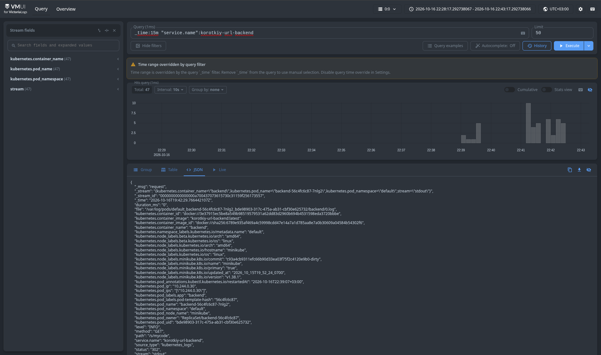
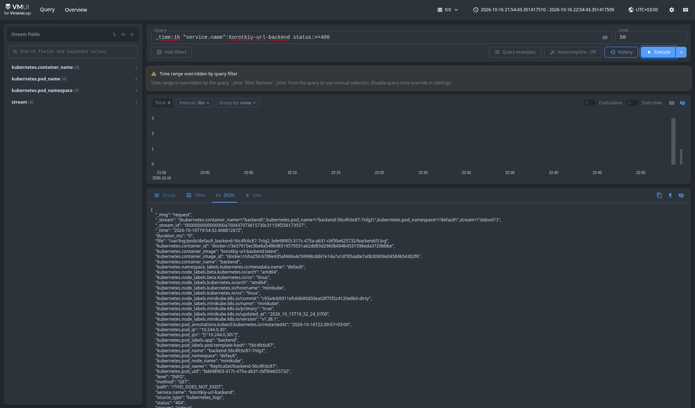
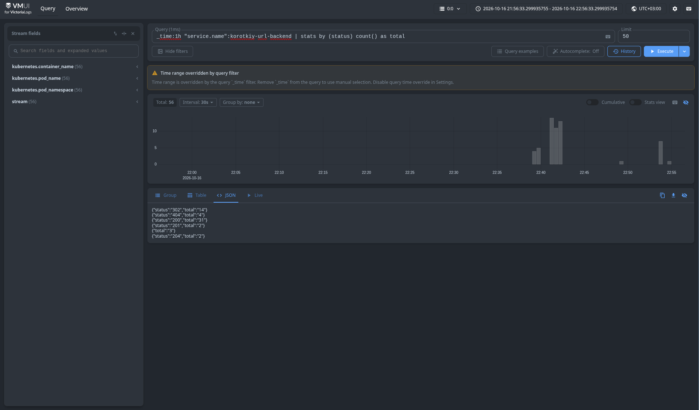
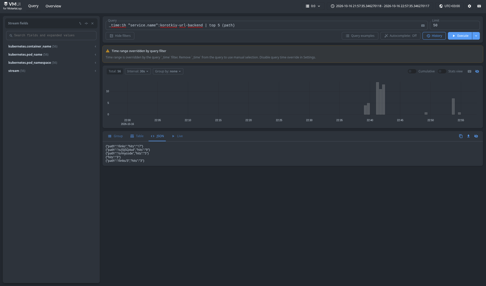

# korotkiy_url - Логгирование (ДЗ 3)

## Способ доставки

Среди агентов я выбрал Vector (DaemonSet)

Он легкий (написан на Rust), имеет встроенный источник kubernetes_logs с метаданными подов и удобный язык трансформаций VRL

Также он легко настраивается под Victoria Logs, и в целом показался мне самым простым

Fluent Bit был бы ещё более легким по ресурсам и тоже подошёл бы, но у Vector удобнее трансформации

OTel Collector избыточен, так как нужны только логи

Fluentd и Logstash тяжелее (Ruby и JVM), это лишние ресурсы

Filebeat привязан к экосистеме Elastic

## LogsQL-запросы

### (а) Сырые записи за последние 15 минут

```
_time:15m "service.name":korotkiy-url-backend
```



Показывает все логи бэкенда за последние 15 минут. Фильтр по `service.name` оставляет только записи бэкенда

Видно, что поля `method`, `path`, и другие разобраны отдельно от `_msg`

### (б) Фильтр по полю

```
_time:1h "service.name":korotkiy-url-backend status:>=400
```



Показывает только запросы, завершившиеся ошибкой (HTTP-статус 400 и выше) за последний час

### (в) stats с группировкой

```
_time:1h "service.name":korotkiy-url-backend | stats by (status) count() as total
```



Считает, сколько запросов за последний час закончилось каждым HTTP-статусом, показывается как распределение

### (г) Агрегирующий запрос (top)

```
_time:1h "service.name":korotkiy-url-backend | top 5 (path)
```



Выводит 5 самых часто запрашиваемых путей и количество обращений к каждому, так можно посмотреть какие эндпоинты нагружены больше всего
