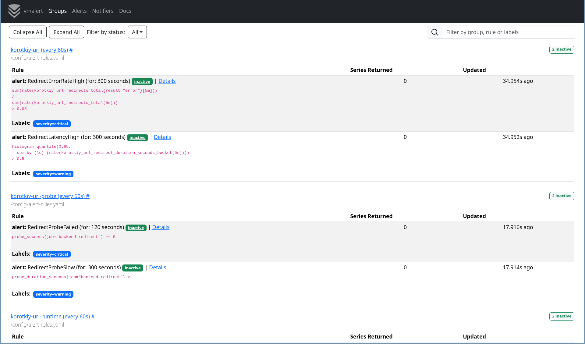

# korotkiy-url - Grafana (ДЗ 7)

## Скриншоты

### Основной дашборд

### Дашборд PostgreSQL Exporter

## Разбор основного дашборда

Дашборд разделен на 4 ряда:
- Обзор сервиса
- Бизнес панели
- RED
- Рантайм панели
При построении старался придерживаться подхода Drill-down

### Панели в обзоре сервиса
- Backend UP
- Postgres UP
- Total links
- HTTP error rate
- Prober SLI
Почему: вся основная информация о состоянии приложения кратко наверху
Включает в себя всё понемногу: рантайм метрики (up), бизнес метрики (total links) и prober SLI метрику

### Бизнес панели
- Created links per second
- Redirects by result
- Redirect latency
Почему: основные бизнес-функции приложения - редирект при посещении ссылки (две панели про это) и создание новых ссылок

### Панели в RED
- RPS
- HTTP errors
- Request latency (p95)
Почему: классические RED панели
При необходимости можно в будущем добавить USE/Golden Signals, но для такого простого приложения не вижу смысла

### Рантайм панели
- Memory usage
- CPU usage
- Goroutines
Основные метрики рантайма, которых достаточно чтобы диагностировать основные проблемы с приложением

## Источники данных
Используется victoriametrics-metrics-datasource
