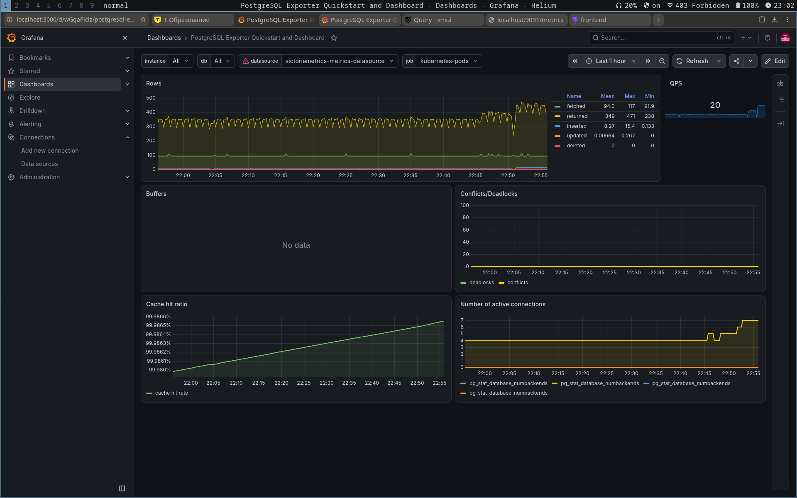
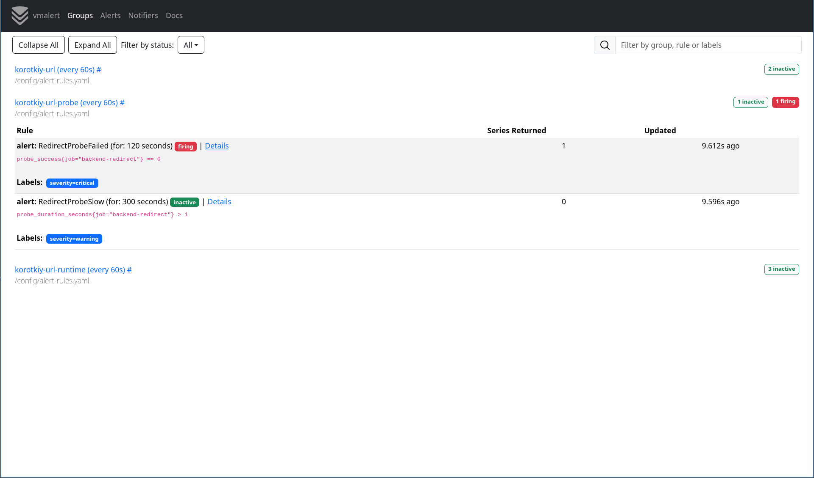
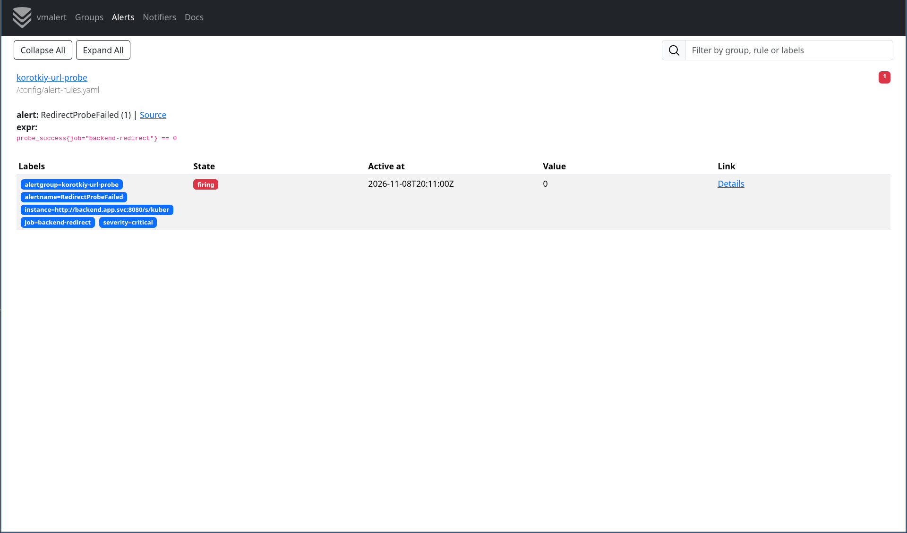
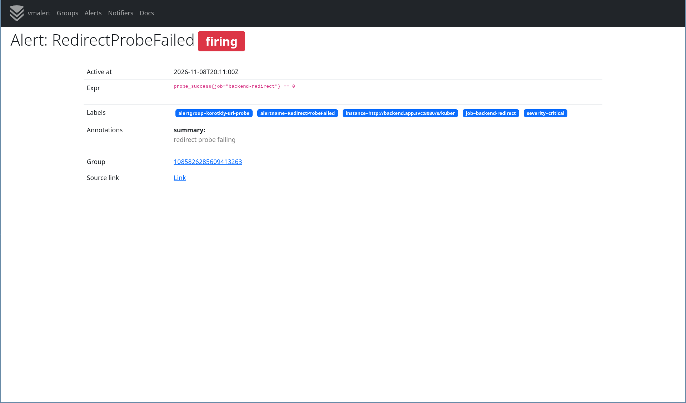
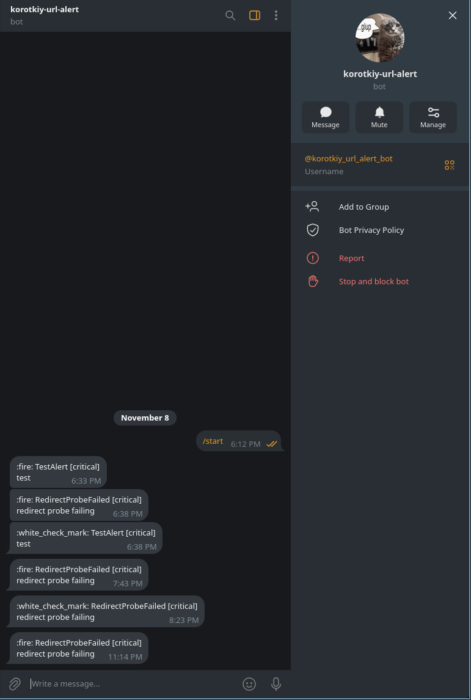

# korotkiy_url - Алерты (ДЗ 6)

## Какие алерты сделаны

### Группа korotkiy-url-runtime (метрики рантайма)

- CPUHigh - warning, использование CPU выше 80%
- MemoryHigh - warning, бэкенд начинает потреблять слишком много памяти (>200мб)
- GoroutinesHigh - warning, у бэкенда одновременно запущено более 500 горутин

### Группа korotkiy-url (метрики сервиса)

- RedirectErrorRateHigh - critical, более 5% редиректов завершаются ошибкой
- RedirectLatencyHigh - warning, p95 редиректа > 500ms

### Группа korotkiy-url-probe (метрики пробера)

- RedirectPRobeFailed - critical, редирект пробер вернул не 302 (успешный редирект)
- RedirectProbeSlow - warning, пробер работает дольше одной секунды

### Примечания к алертам
Пограничные значения срабатывания некоторых алертов я взял условные
По факту нужно смотреть какое значение у метрик обычно на реальном трафике, и уже относительно этого выставлять допустимый максимум

severity я выбирал по следующему принципу:
- если значение выше нормы, но приложение нормально может продолжать работу и пользователи это почти не замечают, то это warning
- если приложение уже сломалось или пользователи могут начать ощущать сбой, то это critical

Ещё мне кажется, что имеет смысл сделать некоторые алерты парными (например, если метрика 80%, то это - warning, а 90% - critical)

## Скриншоты

### vmalert, вкладка Groups


### vmalert, Алерт pending


### vmalert, Алерт firing




### Алерт прилетел в телеграм


## Конфигурация алертов (k8s/monitoring/victoria-metrics-alert-values.yml:366)

```
  config:
    alerts:
      groups:
        - name: korotkiy-url
          rules:
            - alert: RedirectErrorRateHigh
              expr: |
                sum(rate(korotkiy_url_redirects_total{result="error"}[5m]))
                /
                sum(rate(korotkiy_url_redirects_total[5m]))
                > 0.05
              for: 5m
              labels:
                severity: critical
              annotations:
                summary: "over 5% of the redirects fail"

            - alert: RedirectLatencyHigh
              expr: |
                histogram_quantile(0.95,
                  sum by (le) (rate(korotkiy_url_redirect_duration_seconds_bucket[5m])))
                > 0.5
              for: 5m
              labels:
                severity: warning
              annotations:
                summary: "redirect p95 > 500ms"

        - name: korotkiy-url-runtime
          rules:
            - alert: CPUHigh
              expr: rate(process_cpu_seconds_total{job="kubernetes-pods", app="backend"}) > 0.8
              for: 5m
              labels:
                severity: warning
              annotations:
                summary: ">80% cpu used"

            - alert: MemoryHigh
              expr: process_resident_memory_bytes{job="kubernetes-pods", app="backend"} > 200 * 1024 * 1024
              for: 5m
              labels:
                severity: warning
              annotations:
                summary: ">200mb memory used"

            - alert: GoroutinesHigh
              expr: go_goroutines{job="kubernetes-pods", app="backend"} > 500
              for: 5m
              labels:
                severity: warning
              annotations:
                summary: "goroutines count > 500"

        - name: korotkiy-url-probe
          rules:
            - alert: RedirectProbeFailed
              expr: probe_success{job="backend-redirect"} == 0
              for: 2m
              labels:
                severity: critical
              annotations:
                summary: "redirect probe failing"

            - alert: RedirectProbeSlow
              expr: probe_duration_seconds{job="backend-redirect"} > 1
              for: 5m
              labels:
                severity: warning
              annotations:
                summary: "redirect probe slower than 1s"
```

## Конфигурация alertmanager (k8s/monitoring/victoria-metrics-alert-values.yml:592)

```
  config:
    global:
      resolve_timeout: 5m

    route:
      receiver: telegram
      group_by: [alertname]
      group_wait: 30s
      group_interval: 5m
      repeat_interval: 4h
      routes:
        - matchers:
            - severity="critical"
          receiver: telegram
          repeat_interval: 1h

    receivers:
      - name: telegram
        telegram_configs:
          - bot_token_file: /etc/telegram/token
            chat_id: 5091510734
            parse_mode: HTML
            send_resolved: true
            message: |-
              {{ if eq .Status "firing" }}:fire:{{ else }}:white_check_mark:{{ end }} {{ .CommonLabels.alertname }} [{{ .CommonLabels.severity }}]
              {{ range .Alerts }}{{ .Annotations.summary }}{{ end }}
```
